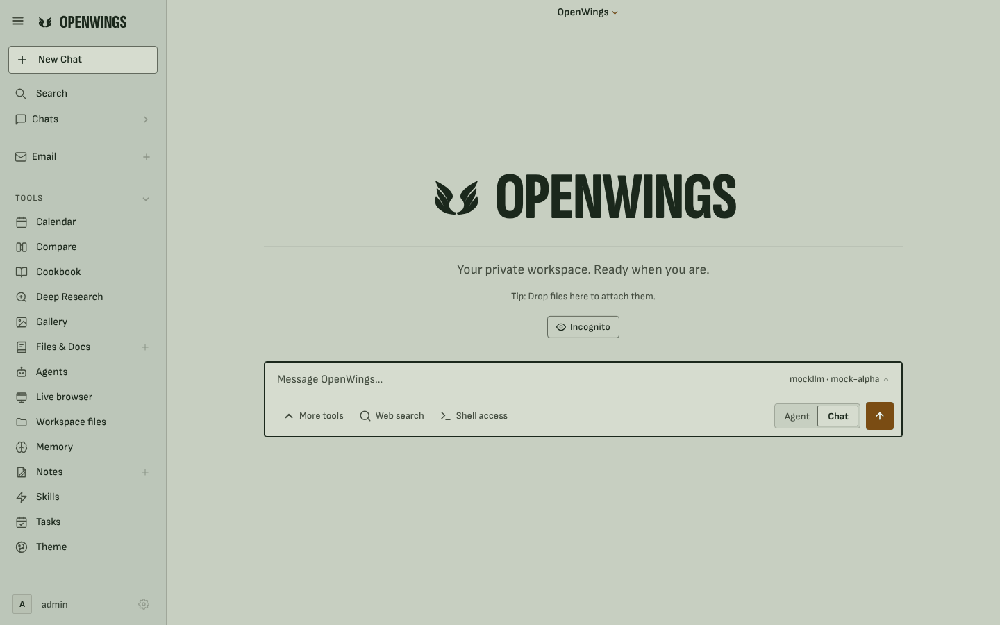
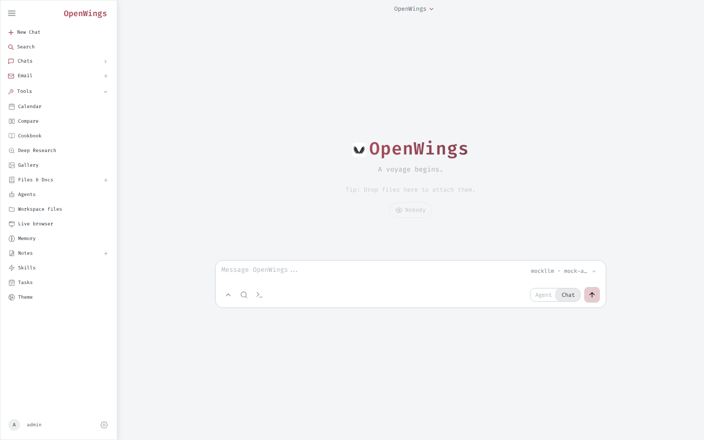
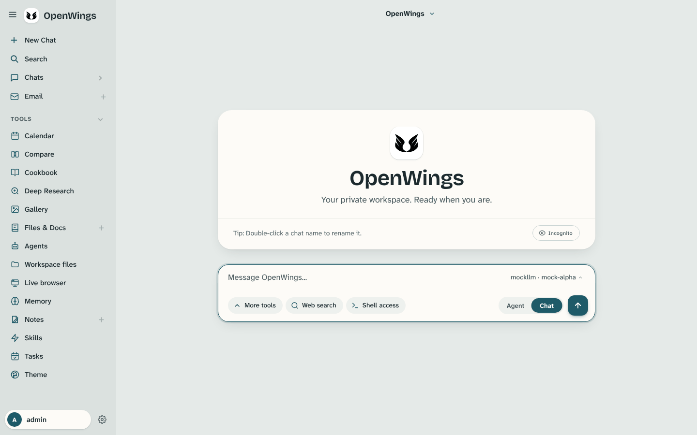
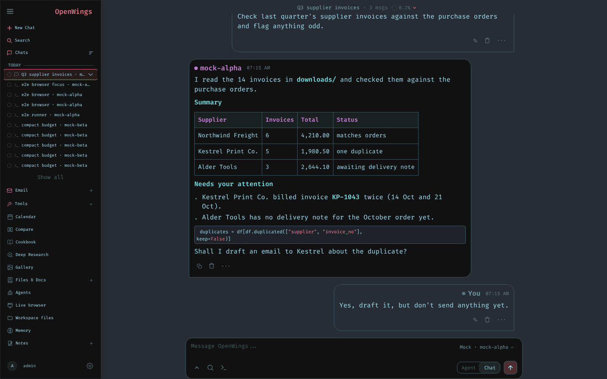
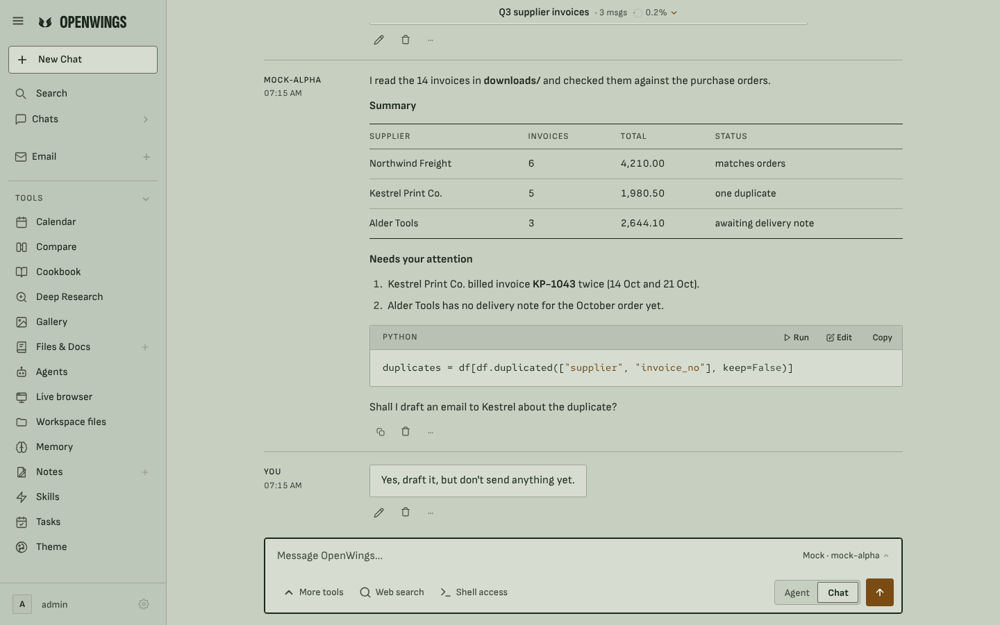
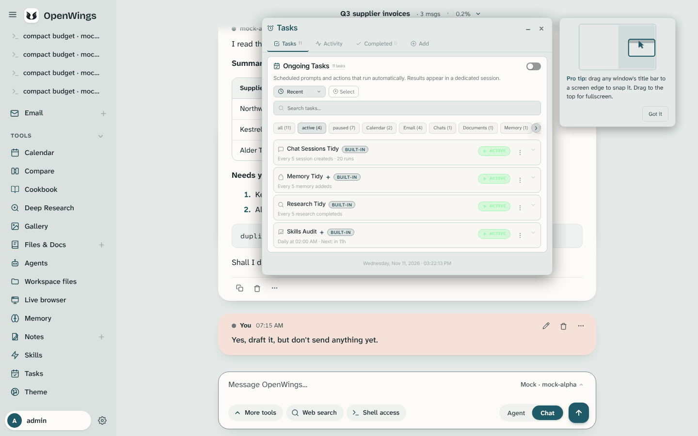
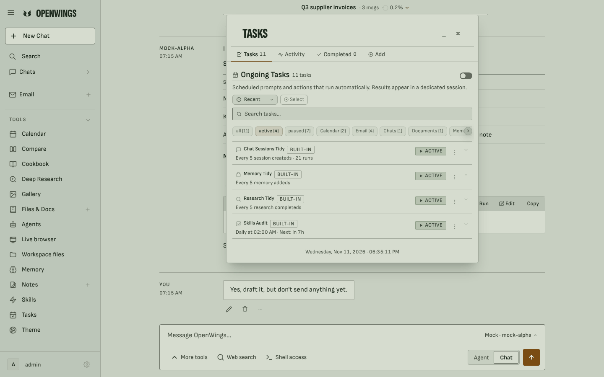
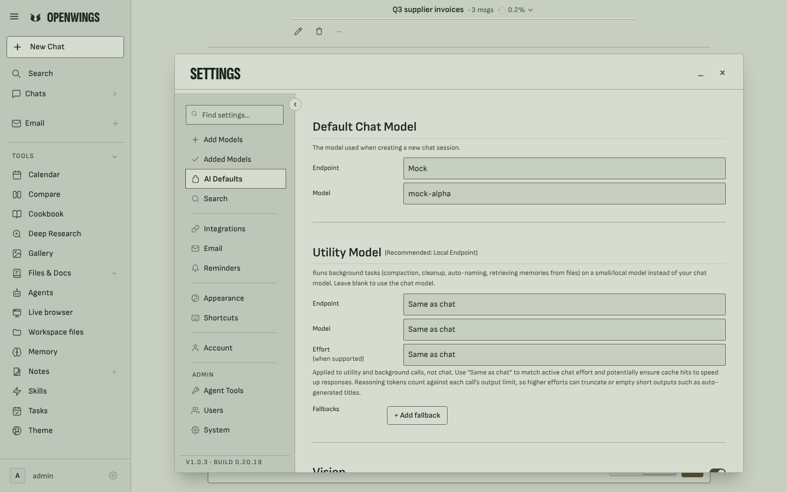

# Lichen, the OpenWings look

Lichen (theme key `ow-sage`) is the look every OpenWings user starts in. It is
one look in one mode for everyone: there is no dark version, and the operating
system's light or dark setting does not change it.

## What it is

Lichen on field stone: a mid-tone sage page, moss-green ink and one deep ochre
accent. Nothing is bright white or near black, and there are no gradients,
glows, blur, purple or neon. All main text meets WCAG AA.

| Role | Colour | Contrast |
| --- | --- | --- |
| Page | `#C7CFC1` (lightness L* 82) | |
| Paper: the message box, your own words, windows, menus | `#D6DCCF` (L* 87) | |
| Side panels: the sidebar, window and Settings navigation | `#BCC6B9` (L* 79) | |
| Ink: all text | `#1B281C` | 9.6:1 on the page |
| Muted ink: secondary text | `#454D40` | 5.5:1 on the page |
| Accent, ochre: the main action, the current choice, focus and state only | `#7A4C13` | 4.6:1 on the page |
| Errors and destructive actions, oxblood | `#8F3222` | 5.0:1 on the page |

**Type.** Sofia Sans for everything you read or press (16px body text, 1.55
line height, at most 68 characters per line). Sofia Sans Extra Condensed,
bold and uppercase, for focal titles only: the 96px welcome title, the 72px
login wordmark and the window titles. Red Hat Mono for code only. All three
are open-licence fonts served by OpenWings itself (their licences are in
`overlay/app/wings/brand/fonts/`). Under any OpenWings look the browser does
not request upstream's fonts (Fira Code, Inter) at all.

**Layout.** The chat reads like a ledger: who spoke and when sits in a narrow
128px column, the words in a reading column beside it, with a thin rule
between turns. The main column is 920px wide on a 12-column grid. Answers sit
on the page; your own words sit on a paper slip. Tables use rules, not boxes,
with figures in equal widths. Every tool window and Settings shares one frame:
a paper surface, a condensed title, tabs underlined in ochre and sections
divided by rules.

**Motion.** Motion is rare and quiet, and it is done by
`overlay/app/wings/brand/motion.js` (loaded by the app page, and inactive under
any other theme):

* the welcome screen rises in once when the page loads (the title 16px over
  400ms, the rest 8px); New Chat does not replay it;
* new answers rise 4px; opening a chat does not animate its history;
* windows grow in from 96% size; tab switches cross-fade with an 8px slide
  (on clicks only, never from the keyboard);
* a chat's title moves from its sidebar row to the top bar; a window moves
  into the tile it snaps to; numbers count up once;
* hover grows clickable things to 102% over 150ms; a press shrinks them to
  97% in 100ms and lets go in 200ms.

With "reduce motion" switched on in the operating system, nothing moves: hover
and press stay at 100%, entrances do not play and numbers do not count.

**Busy states.** While something is working, a neutral mark shows: three small
dots that slowly fade in and out together. It replaces upstream's sea-themed
spinners (a whirlpool, a sine wave and a dot riding an ASCII wave).

## Where the tokens are

Every value the look uses is a design token:

* **`overlay/app/wings/brand/tokens.css`** is the source of truth. It has three
  layers: base colours, named roles (with the measured contrast of each colour
  role in a comment) and component values. It covers colour, type sizes and
  weights, line heights, spacing, the grid, corner radius, borders, shadows,
  motion curves and durations, and layers. A reduced-motion block sets every
  movement value to zero. The app serves it at `/static/openwings/tokens.css`.
* **`overlay/app/wings/brand/tokens.json`** holds the same values in the W3C
  design-token format, for design tools. It is generated from `tokens.css`, so
  the two cannot drift apart: change `tokens.css`, then run
  `python3 scripts/dev/brand/lichen/build.py`.

All tokens apply only under `html[data-ow-skin="ow-sage"]`, so no other theme
sees them.

## The other files

| File | What it is |
| --- | --- |
| `overlay/app/wings/brand/skins.css` | The entry point the app links: it imports `tokens.css` and the three looks, sets each look's first-paint colours, keeps upstream's hard-coded fonts out of the looks, and styles the busy mark. |
| `overlay/app/wings/brand/looks/sage.css` | Lichen itself. It is generated: edit `scripts/dev/brand/lichen/sage.src.css` (where `@@` stands for the look's scope) and run `python3 scripts/dev/brand/lichen/build.py`. |
| `overlay/app/wings/brand/motion.js` | The motion described above. It only runs while Lichen is active. |
| `overlay/app/wings/brand/looks/duet.css`, `hush.css` | The two other OpenWings looks, Duet and Hush, each with a night version. |
| `patches/0023-openwings-lichen.patch` | Makes Lichen the default, loads `motion.js`, limits the theme picker to the OpenWings looks, keeps upstream's fonts and spinners out of the looks. |
| `patches/0024-openwings-wording.patch` | Replaces the upstream name and its sea wording in everything people see or receive. |
| `tests/unit/test_wings_looks.py` | Checks that the theme list, the first-paint colours, the stylesheets, the default look, the font rules and the busy mark stay consistent. |

## The theme picker

The theme picker lists the OpenWings looks only, in this order: Lichen, Duet,
Duet night, Hush, Hush night. Upstream's themes are still in the app: someone
who chose one before keeps it (and sees it in the picker while it is active),
and `/theme <name>` still applies one. To list them in the picker for everyone,
set `WINGS_SHOW_CLASSIC_THEMES=1` in `.env`.

## Before and after

The full audit, with the reasoning behind each change, is in
[AUDIT.md](AUDIT.md).

| Before | After |
| --- | --- |
|  Upstream: monospace everywhere, "A voyage begins.", "Nobody" |  Lichen |
|  Duet, the previous default: white paper in a rounded card |  Lichen: one focal point, no card |
|  Upstream: cyan on near black, boxed bubbles, purple table headers |  Lichen: the ledger layout, ruled table, labelled code strip |
|  Duet: a card inside the window, 9-10px faded meta text |  Lichen: one window frame, ruled rows, 12px and larger text |
| |  Lichen Settings: labels in one column, sections divided by rules |
